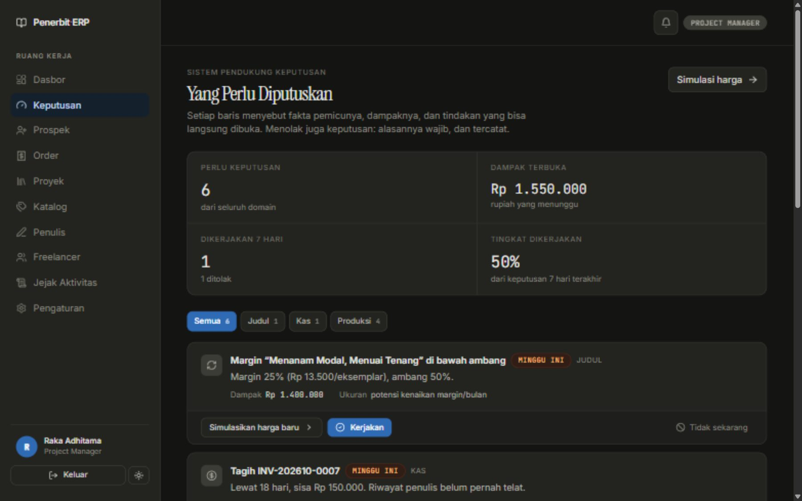
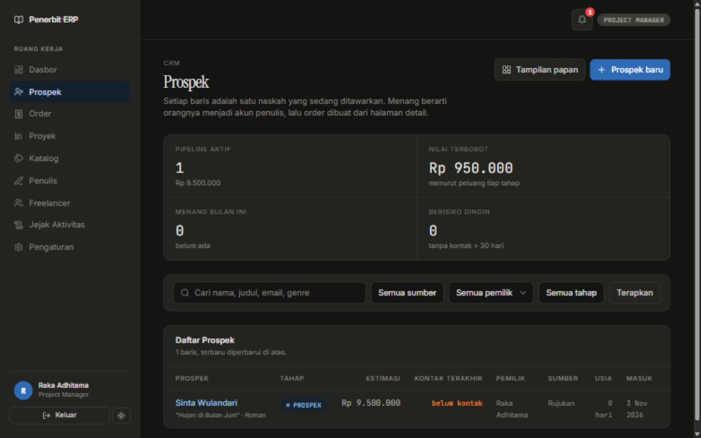
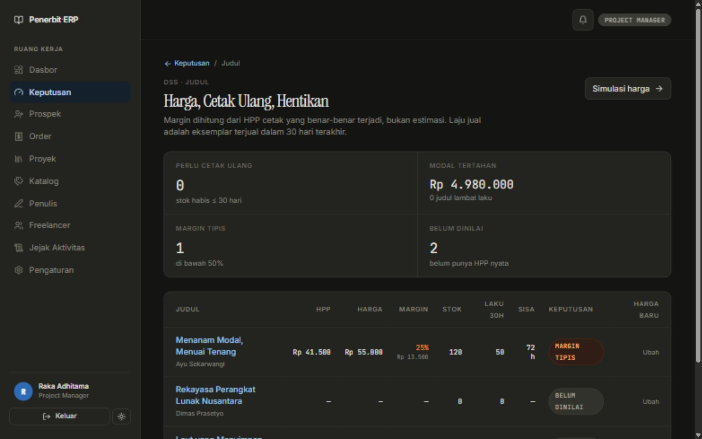
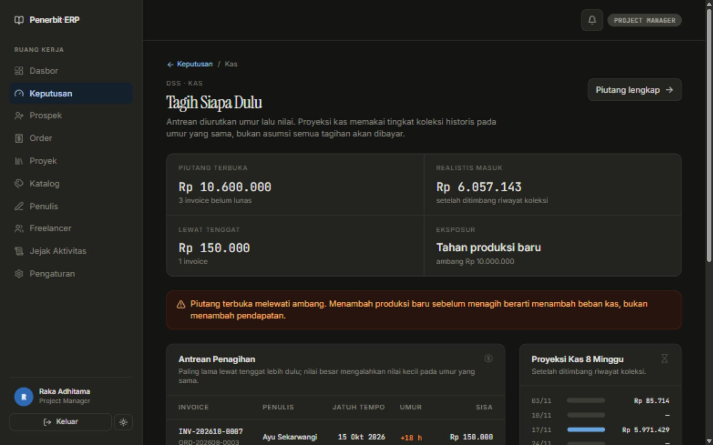
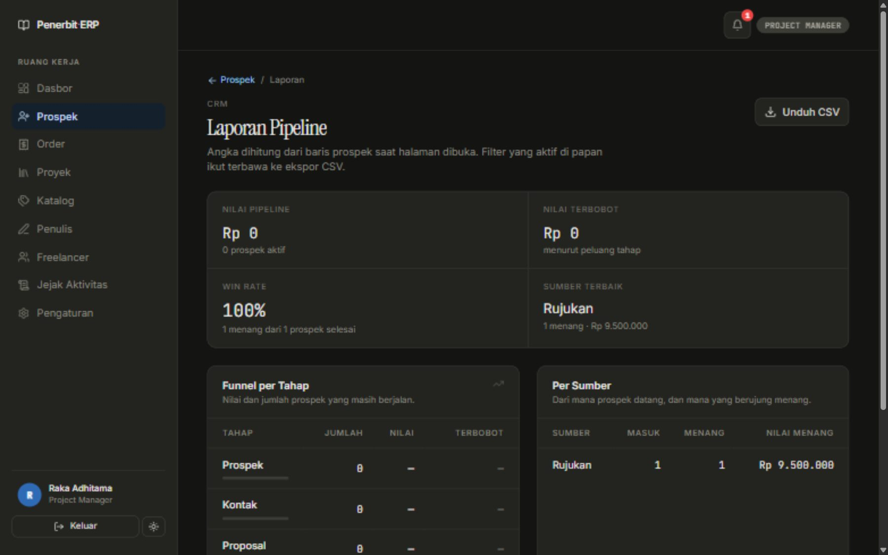
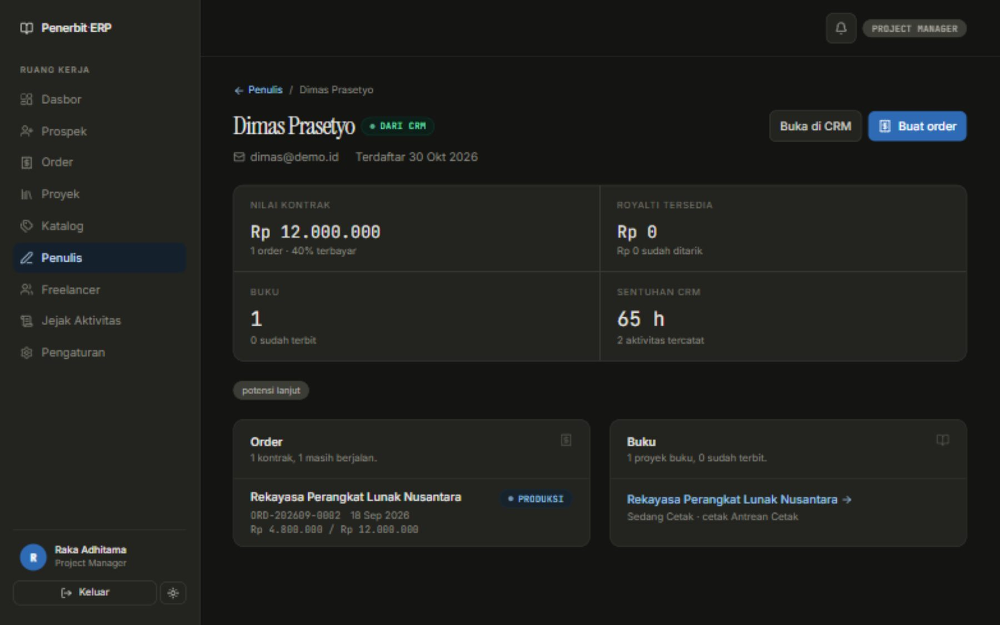
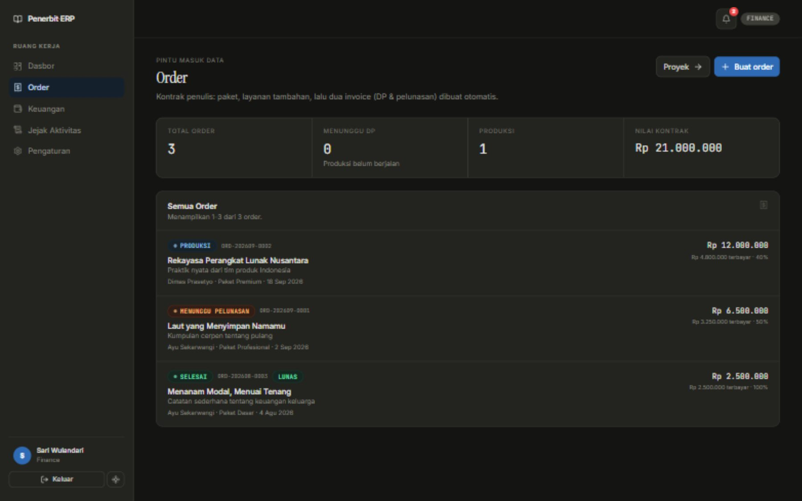
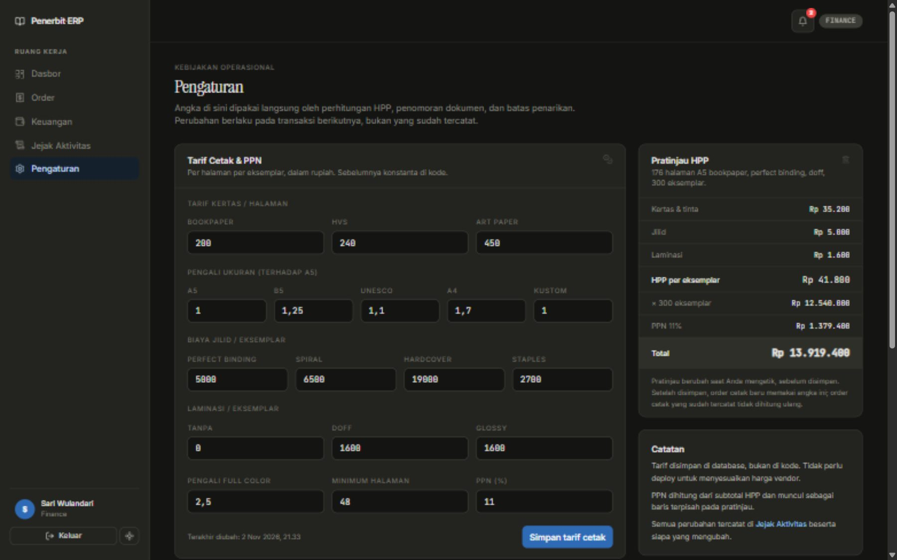
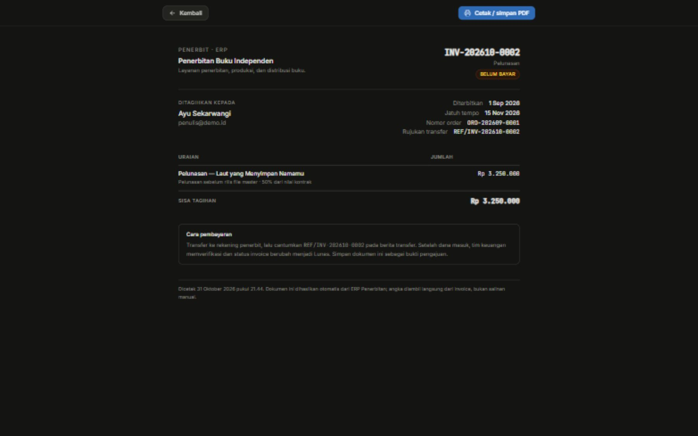

# Penerbit ERP

**ERP + CRM + DSS untuk penerbitan buku indie.** Dari prospek yang belum jadi penulis, sampai kontrak, produksi empat track paralel, cetak, penjualan, royalti, dan keputusan "judul mana yang harus dicetak ulang minggu ini" — semuanya di satu tempat, dengan jejak yang bisa ditelusuri.

Dibangun dengan SvelteKit 5 + PostgreSQL. Bahasa antarmuka: Indonesia.

[](LICENSE)




---

## Kenapa proyek ini ada

Penerbitan buku indie punya satu masalah yang jarang dijawab software: **alurnya bukan satu garis**. Satu naskah dikerjakan editor, desainer cover, dan tim legal secara **paralel**, sementara uang berjalan di jalur lain (DP, pelunasan, revisi ekstra, cetak, royalti). ERP generik memaksa semua itu jadi satu status tunggal, lalu tim mengakalinya dengan spreadsheet.

Tiga hal yang membuat ERP ini beda:

1. **Order adalah kontraknya.** Membuat order langsung menghasilkan dua invoice (DP + pelunasan) dalam satu transaksi. DP lunas memicu pembuatan proyek + 5 task produksi + baris inventori. Tidak ada tabel "deal" kembar yang menduplikasi nilai uang.
2. **Empat track produksi berjalan sendiri-sendiri.** Editorial & Layout, Cover, Legal & ISBN, Cetak punya tahapannya masing-masing. Statusnya terpisah karena kenyataannya terpisah.
3. **DSS, bukan cuma dasbor.** Dasbor menjawab "apa yang terjadi", laporan menjawab "berapa totalnya". DSS menjawab **"jadi saya harus apa"** — dengan fakta pemicu, ambang yang bisa diubah, dampak rupiah, dan tombol *kerjakan / tidak sekarang* yang tercatat beserta alasannya.

---

## Isi sistem

### Inti: order → invoice → proyek → cetak → penjualan

| Modul | Halaman | Yang bisa dilakukan |
|---|---|---|
| Dasbor operasional | `/admin` | KPI, kas masuk per bulan, piutang menua, funnel kontrak, HPP vs harga jual, beban track |
| Order | `/orders` | Buat kontrak + 2 invoice otomatis, batalkan (hanya bila belum ada pembayaran) |
| Proyek | `/projects`, `/projects/[id]` | 4 track produksi, task, revisi, komentar, unggah naskah/cover/PDF, kunci versi optimistik |
| Keuangan | `/admin/finance` | Verifikasi pembayaran (satuan & massal), piutang per umur, proses penarikan saldo |
| Katalog | `/admin/katalog` | Paket (harga, DP%, royalti%, kuota revisi) dan layanan à la carte |
| Penulis | `/admin/penulis`, `/admin/penulis/[id]` | Direktori + profil 360 (kontrak, royalti, buku, sentuhan CRM) |
| Freelancer | `/admin/freelancer` | Direktori, spesialisasi, aktivasi akun |
| Jejak aktivitas | `/admin/audit` | Semua perubahan uang/status/isi karya, dengan diff |
| Pengaturan | `/admin/pengaturan` | Tarif cetak, PPN, prefix nomor dokumen, minimum penarikan, **ambang keputusan DSS** |
| Portal penulis | `/portal` | Progres buku, review hasil, unduh (file HD hanya setelah lunas), dompet royalti |
| Ruang freelancer | `/freelancer` | Tugas, kirim hasil, komisi |
| Dokumen cetak | `/invoice/[id]`, rekap HPP | Layout A4 khusus cetak, tanpa navigasi |

**Mesin ERP** (`erpEngine.ts`) menangani 11 operasi yang menyentuh uang atau status: invoice dibayar, penugasan task, revisi (dengan invoice ekstra saat kuota habis), persetujuan (kredit komisi idempoten), order cetak (HPP dari tarif pengaturan), penerimaan cetakan (HPP rata-rata tertimbang), penjualan (royalti dari laba kotor), dan penarikan saldo.

### CRM — prospek sampai jadi penulis



Dirancang dari pertanyaan: *bagian CRM mana yang benar-benar dibutuhkan penerbit buku?* Jawabannya: satu prospek = **satu naskah + satu paket**, bukan "deal" abstrak.

- **Papan pipeline** 4 tahap (Prospek → Kontak → Proposal → Negosiasi) dengan KPI pipeline aktif, nilai terbobot, menang bulan ini, prospek berisiko dingin. Di ponsel kolomnya bertumpuk, bukan papan yang harus digeser.
- **Konversi menang** membuat akun penulis (lewat `auth.users`), atau menyambung ke akun yang sudah ada, lalu membawa ke `/orders` dengan form sudah terbuka dan terisi. Satu orang, satu identitas, riwayat percakapan tetap menempel.
- **Timeline aktivitas** (telepon/WA/email/pertemuan/catatan). `lastContactAt` adalah turunan, bukan isian manual — menghapus aktivitas menghitung ulang dari sisa.
- **Tugas follow-up** dengan tenggat, dan notifikasi jatuh tempo/prospek dingin yang memakai `dedupeKey` supaya tidak membanjiri lonceng.
- **Laporan** funnel, win rate (hanya prospek selesai), sumber terbaik, tren 12 bulan, aktivitas per staf.
- **Ekspor CSV** mengikuti filter aktif, BOM UTF-8 + pemisah `;`.

### DSS — yang perlu diputuskan, bukan cuma angka



Setiap rekomendasi wajib punya enam bagian: **fakta → ambang → alasan → dampak rupiah → tindakan → jejak**. Tidak ada skor yang disimpan; semuanya dihitung dari baris nyata saat halaman dibuka.

| Halaman | Menjawab |
|---|---|
| `/dss` | "Hari ini saya harus memutuskan apa?" — rekomendasi 3 domain, diurut urgensi lalu dampak rupiah |
| `/dss/judul` | "Cetak ulang, naikkan harga, atau hentikan?" — margin dari HPP nyata, laju jual 30 hari, hari stok tersisa, harga minimum untuk margin target |
| `/dss/kas` | "Tagih siapa dulu?" — antrean berperingkat umur→nilai→riwayat, proyeksi kas 8 minggu, konsentrasi piutang, saran tahan produksi |
| `/dss/produksi` | "Apa yang akan telat?" — beban per track + umur task tertua, beban freelancer, risiko tenggat, task macet |
| `/dss/simulasi` | "Sebelum dijanjikan ke penulis" — HPP/eksemplar, margin, royalti, BEP, harga minimum, skenario tersimpan |
| `/dss/riwayat` | "Apakah keputusan kita benar?" — semua keputusan + alasan penolakan + angka saat memutuskan |

Contoh rekomendasi yang benar-benar muncul dari data:

> **Margin "Menanam Modal, Menuai Tenang" di bawah ambang** — 25% (Rp 13.500/eksemplar), ambang 50%.
> **Tagih INV-202610-0007** — lewat 18 hari, sisa Rp 150.000. Riwayat penulis belum pernah telat.
> **"Tata Letak & Proofreading Akhir" tidak bergerak — Rekayasa Perangkat Lunak Nusantara** — 90 hari tanpa perubahan status.

Dua keputusan desain yang penting:

- **Proyeksi kas berbobot riwayat koleksi**, bukan asumsi "semua tagihan akan dibayar". Tiap tagihan ditimbang rasio lunas historis pada bucket umurnya. Proyeksi optimis membuat keputusan menahan produksi tidak pernah diambil.
- **Harga jual buku ≠ harga kontrak paket.** `packages.base_price` adalah harga jasa penerbitan. Mencampurnya pernah menghasilkan margin 98% palsu di simulasi; sekarang simulasi hanya mengambil persentase royalti dari paket, harga jual dari retail inventori.

---

## Tampilan

| | |
|---|---|
|  |  |
|  |  |
|  |  |

Setiap halaman diuji di **desktop 1440×900** dan **ponsel 390×844**. Tabel berubah jadi kartu di layar sempit, dari satu definisi kolom yang sama — tidak ada markup data ganda yang bisa melenceng.

---

## Teknologi

| Lapisan | Pilihan |
|---|---|
| Framework | SvelteKit 5 (runes) + TypeScript |
| Database | PostgreSQL (Supabase), Drizzle ORM, 7 migrasi idempoten |
| Auth | Supabase Auth — atau sesi dev lokal bila kunci Supabase kosong |
| UI | Tailwind CSS + komponen sendiri, bits-ui (dialog), lucide (ikon) |
| Tabel | TanStack Table (seleksi baris saja; sort/filter/pagination di server) |
| Grafik | layerchart, warna lewat CSS var agar ikut tema terang/gelap |
| Berkas | Supabase Storage, Cloudinary, atau disk lokal `.data/uploads` |

Tidak ada `node_modules` berat di sisi UI: 18 komponen, 5 file grafik, semuanya bisa dibaca dalam satu duduk.

---

## Menjalankan

```bash
git clone <repo-url>
cd erp-book-publisher
npm install
cp .env.example .env      # isi DATABASE_URL
node scripts/db-migrate.mjs
node scripts/seed.mjs     # data demo: 3 order, 3 proyek, 4 penjualan
npm run dev               # http://localhost:5173
```

Akun demo (kata sandi semuanya `penerbit123`):

| Email | Peran | Halaman |
|---|---|---|
| `nadia@penerbit.co.id` | SUPER_ADMIN | semua |
| `raka@penerbit.co.id` | PROJECT_MANAGER | order, proyek, CRM, DSS |
| `sari@penerbit.co.id` | FINANCE | keuangan, piutang, DSS |
| `edwin@freelance.id` | FREELANCER | ruang freelancer |
| `penulis@demo.id` | AUTHOR | portal penulis |

Pemeriksaan sebelum menandai pekerjaan selesai:

```bash
npx svelte-check --tsconfig ./tsconfig.json   # harus 0 error, 0 warning
npm run build
```

---

## Struktur repo

```
src/
  routes/
    (app)/             halaman ber-navigasi (admin, order, proyek, crm, dss, portal…)
    (print)/           layout cetak A4 tanpa navigasi
  lib/
    server/
      db/schema.ts     sumber kebenaran skema (33 tabel, 29 enum)
      services/        21 file: erpEngine, orders, leads, crm, dss, printing, settings…
      auth/            rbac + sesi dev
    components/        18 komponen (DataTable, CurrencyInput, Toaster, ConfirmHost…)
    charts/            grafik + format angka ringkas
    table/             bahasa query URL, tipe kolom, filter periode
    client/            form handler (idempotensi), toast, konfirmasi
    printMath.ts       rumus HPP murni — dipakai server DAN klien
drizzle/               0000–0006, idempoten
scripts/               migrate + seed
docs/                  roadmap CRM, roadmap DSS, overview sistem
```

---

## Dokumen

- [`docs/ERP-OVERVIEW.md`](docs/ERP-OVERVIEW.md) — inventaris lengkap: modul, alur, aturan bisnis, skema, 12 keputusan teknis, batasan
- [`docs/CRM-ROADMAP.md`](docs/CRM-ROADMAP.md) — rencana + status CRM, prinsip, non-goals
- [`docs/DSS-ROADMAP.md`](docs/DSS-ROADMAP.md) — rencana + status DSS, kontrak rekomendasi, catatan implementasi

---

## Keputusan teknis yang membedakan

- **Idempotensi di kunci klien.** `requestId` dibuat sebelum `fetch` dan dikunci `Set` biasa (bukan state reaktif); server memakainya sebagai `idempotency_keys`. Dua tap cepat tidak menggandakan invoice.
- **Penguncian optimistik** via `book_projects.version`. Dua PM yang membuka proyek bersamaan tidak bisa saling menimpa diam-diam — yang kalah dapat 409 + data terbaru.
- **Uang tidak boleh hilang dari jejak.** Order dengan pembayaran tidak bisa dibatalkan; invoice `VOID` tetap ada.
- **HPP rata-rata tertimbang**, bukan rata-rata sederhana, supaya royalti tidak melonjak setelah cetak ulang yang lebih mahal.
- **Satu rumus HPP untuk server dan browser.** `printMath.ts` dipakai mesin ERP dan simulasi DSS. Dua salinan rumus akan melenceng, dan simulasi yang melenceng lebih berbahaya daripada tidak ada simulasi.
- **Konten terlihat tanpa JavaScript.** Tidak ada reveal `opacity:0` yang menunggu scroll.
- **Grafik selalu disertai tabel angka.** SVG tidak terbaca pembaca layar dan tidak berguna saat dicetak hitam-putih.

---

## Status

Semua modul di atas sudah berjalan dan diuji end-to-end: order → invoice → produksi → cetak → penjualan → royalti → penarikan, CRM penuh, DSS 5 fase, cetak dokumen.

Yang **sengaja belum** dibuat beserta alasannya ada di [`docs/ERP-OVERVIEW.md` §14](docs/ERP-OVERVIEW.md#belum) — antara lain email blast/SMTP, WhatsApp API, skoring ML, optimasi jadwal LP, dan rule builder bebas untuk DSS.

---

## Lisensi

[MIT](LICENSE) © 2026 fla1r

Boleh dipakai, diubah, dijual, dan didistribusikan ulang — termasuk secara komersial — selama notice hak cipta dan izin ini disertakan. Tanpa jaminan apa pun.

```text
Copyright (c) 2026 fla1r
```

---

## Kontribusi

Repo ini publik dan terbuka untuk siapa pun.

1. Fork, buat branch (`feat/nama-fitur` atau `fix/nama-bug`).
2. Jalankan `npx svelte-check --tsconfig ./tsconfig.json` dan `npm run build` — keduanya harus bersih sebelum PR.
3. Uji perubahannya di desktop **dan** ponsel; sertakan tangkapan layar bila menyentuh UI.
4. Jangan commit `.env`, kredensial, atau data uji dari database lokal.
5. Satu PR untuk satu hal. Jelaskan **mengapa**, bukan hanya apa.

Laporkan bug lewat Issues dengan langkah reproduksi. Untuk perubahan besar, buka diskusi dulu supaya tidak ada pekerjaan yang terbuang.

### Sebelum push: periksa kredensial

Empat skrip audit tersedia. Semuanya **tidak pernah mencetak nilai rahasia** — hanya lokasi dan sidik jari.

```bash
node scripts/audit-secrets.mjs    # nilai .env persis di seluruh objek git
node scripts/audit-push.mjs       # simulasi: apa yang benar-benar dikirim ke remote
node scripts/audit-patterns.mjs   # pola kredensial umum (JWT, AWS, token, private key)
node scripts/audit-personal.mjs   # data pribadi non-kredensial (email commit, nomor HP, rekening)
```

`audit-push.mjs` adalah yang paling ketat: ia mengumpulkan setiap blob di semua ref yang akan naik, menyusun fragmen rahasia dari `.env` (password database, project-ref Supabase, kunci Cloudinary), lalu memastikan tidak satu pun muncul.
